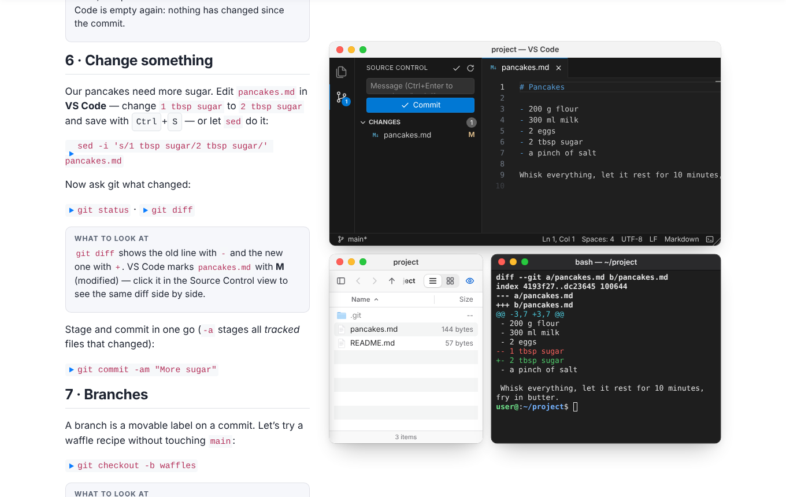

# Quarto OS

A [Quarto](https://quarto.org) extension that renders **macOS-style windows**, a **fake
desktop** and a **real Linux VM** — terminal, VS Code-like editor, Finder-like file
explorer — inside HTML documents, websites and reveal.js slides. Built for teaching:
show `git` in a terminal next to an explorer that displays `.git` and an editor with
source control, all running in the reader's browser.

**Examples & docs: <https://jansim.github.io/quarto-os/>**



- **Content windows** around any Markdown: images, video, code, callouts — inline,
  side by side, or floating and draggable; light and dark chrome.
- **Apps on a real VM**: `terminal`, `vscode`, `explorer` (and `browser`), all backed by
  one Debian VM per page, powered by [CheerpX](https://cheerpx.io) (the engine behind
  WebVM). No server needed.
- **Desktop** with wallpaper, menubar and dock; multiple instances of each app.
- **Launch buttons** and clickable **run snippets** that type commands into a terminal.
- **Lazy**: pages only load a small core; xterm.js, Monaco and CheerpX are loaded when
  a window needs them.

## Install

```bash
quarto add jansim/quarto-os
```

Then enable the filter in a document's front matter or in `_quarto.yml`:

```yaml
filters:
  - quarto-os
```

## Usage

````markdown
::: {.os-window title="hello.py"}
```python
print("Hello from a window!")
```
:::

::: {#shell .os-window app="terminal" height="300px" cwd="~"}
:::

Click to run: `python3 --version`{.os-run target="shell"}




::: {#desk .os-desktop height="520px" dock="terminal,vscode,explorer"}
::: {.os-window app="terminal" x=40 y=40 width=520 height=300}
:::
:::

[New terminal]{.os-launch app="terminal" target="desk" cwd="~/repo"}
````

### Window attributes

| Attribute | Meaning |
|---|---|
| `app` | `content` (default), `terminal`, `vscode`, `explorer`, `browser` |
| `title` | Title bar text |
| `width`, `height` | CSS lengths; bare numbers are px |
| `x`, `y` | Position (px) when floating (desktop, slide, or `float=true`) |
| `float` | `true` → absolutely positioned and draggable over its container |
| `#id` | Target for `.os-run` snippets and launchers |
| `theme` | `light` / `dark` chrome |
| `state` | `normal` / `minimized` / `maximized` (desktop only) |
| terminal | `cwd`, `run` (command typed once the shell is ready; `;`-separated ok) |
| vscode | `folder` (workspace root), `open` (comma-separated files) |
| explorer | `path` (start directory), `hidden` (show dotfiles, default `true`) |
| browser | `url` |

Desktops (`.os-desktop`) take `height` (default `480px`), `dock` (default
`terminal,vscode,explorer`), `menubar` (default `true`), `title` and `wallpaper`.

### Document options

```yaml
quarto-os:
  theme: light            # default chrome theme (light|dark)
  coi: true               # register coi-serviceworker.js on pages using the VM
  vm:
    disk: wss://disks.webvm.io/debian_buster_large_permis_fixed_01-06-2026.ext2
    disk-type: cloud      # cloud | github | bytes
    persist: false        # keep VM disk changes across reloads (IndexedDB)
    cache-id: quarto-os   # IndexedDB name for the overlay
    autoboot: false       # boot on page load instead of on first VM window
    setup: |              # bash script run once per fresh VM before apps attach
      mkdir -p ~/repo
```

The full reference is on the [docs site](https://jansim.github.io/quarto-os/#reference).

## How it works

- `quarto-os.lua` turns the Markdown syntax into plain HTML with JSON options and
  attaches the small core (`quarto-os.js` + `quarto-os.css`).
- The core draws windows and desktops and lazy-loads app modules (`apps/*.js`) when a
  window needs them.
- The apps share **one VM per page** (`vm/vm.js`): CheerpX runs a Debian i386 image
  streamed block by block from a disk server. A tiny static agent inside the VM
  (`qos-agent`, C, in `agent/`) multiplexes ptys and file operations over CheerpX's
  single console.
- CheerpX needs `SharedArrayBuffer`, i.e. a cross-origin isolated page. On hosts that
  can't send COOP/COEP headers (GitHub Pages), pages that use the VM register
  `coi-serviceworker.js`, which reloads the page once on the first visit.

Limitations: no network inside the VM, third-party iframes (e.g. YouTube) are blocked
on VM pages, the first boot downloads the engine and disk blocks, Chromium-based
browsers and Firefox are recommended. Details on the
[docs site](https://jansim.github.io/quarto-os/#limitations).

## Development

```
_extensions/quarto-os/   the extension (Lua filter, core JS/CSS, apps/, vm/, vendor/)
agent/                   C source of the in-VM agent + build script
examples/                example pages (rendered to GitHub Pages)
index.qmd, _quarto.yml   docs site
dev/                     test harnesses and a static dev server
```

- **Build the agent** (static i386 binary, cross-compiled with [zig](https://ziglang.org)):
  `agent/build.sh` writes `_extensions/quarto-os/vm/qos-agent`.
- **Render the docs site**: `quarto render` (outputs to `_site/`).
- **Serve it locally** with cross-origin isolation headers and range requests:

  ```bash
  node dev/server.mjs _site 8000          # with COOP/COEP headers
  node dev/server.mjs _site 8000 nocoi    # like GitHub Pages (service worker path)
  ```

- **Regenerate the demo assets** (image + looping video, needs ffmpeg + Playwright):
  `node dev/docs-assets.mjs`.

### Publishing the examples

`.github/workflows/publish.yml` renders the site and deploys `_site/` to GitHub Pages
on every push to `main` (or manually via *Run workflow*). In the repository settings,
set **Settings → Pages → Build and deployment → Source** to **GitHub Actions**.

## Licensing

- [CheerpX](https://cheerpx.io) is proprietary software by Leaning Technologies. It is
  **free for personal use and open-source projects; commercial or organizational use
  requires a license** from Leaning Technologies (see <https://cheerpx.io>). Quarto OS
  loads it at runtime from Leaning Technologies' CDN and does not redistribute it.
- The default disk image is hosted by the WebVM project; the Debian software in it is
  under the licenses of the respective packages.
- Vendored/loaded libraries: [xterm.js](https://xtermjs.org) (MIT),
  [Monaco Editor](https://microsoft.github.io/monaco-editor/) (MIT),
  [coi-serviceworker](https://github.com/gzuidhof/coi-serviceworker) (MIT).
- The images and the video in `examples/assets/` were generated for this project.
