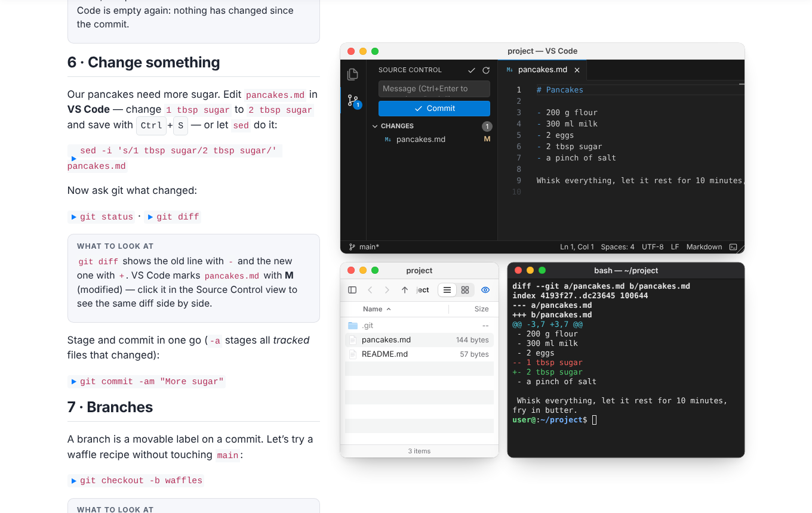

# Quarto OS

A [Quarto](https://quarto.org) extension that renders **macOS-style windows**, a **fake
desktop** and a **real Linux VM** — terminal, VS Code-like editor, Finder-like file
explorer — inside HTML documents, websites and reveal.js slides. Built for teaching:
show `git` in a terminal next to an explorer that displays `.git` and an editor with
source control, all running in the reader's browser.

**Examples & docs: <https://jansim.github.io/quarto-os/>**



- **Content windows** around any Markdown: images, video, code, callouts — inline,
  side by side, or floating and draggable; light and dark chrome.
- **Apps on a real VM**: `terminal`, `vscode`, `explorer` (and `browser`), all backed by
  one Linux VM per page, powered by [unkernel](https://github.com/pithings/unkernel): a
  real Linux kernel compiled to WebAssembly. `git` is ready at once; other commands
  install on first use. No server needed.
- **Desktop** with wallpaper, menubar and dock; multiple instances of each app.
- **Launch buttons** and clickable **run snippets** that type commands into a terminal.
- **Lazy**: pages only load a small core; xterm.js, Monaco and the VM are loaded when
  a window needs them.
- **Self-contained**: build the VM assets once and the rendered site works offline.

## Install

```bash
quarto add jansim/quarto-os
```

Then enable the filter in a document's front matter or in `_quarto.yml`:

```yaml
filters:
  - quarto-os
```

## Usage

````markdown
::: {.os-window title="hello.py"}
```python
print("Hello from a window!")
```
:::

::: {#shell .os-window app="terminal" height="300px" cwd="~"}
:::

Click to run: `python3 --version`{.os-run target="shell"}




::: {#desk .os-desktop height="520px" dock="terminal,vscode,explorer"}
::: {.os-window app="terminal" x=40 y=40 width=520 height=300}
:::
:::

[New terminal]{.os-launch app="terminal" target="desk" cwd="~/repo"}
````

### Window attributes

| Attribute | Meaning |
|---|---|
| `app` | `content` (default), `terminal`, `vscode`, `explorer`, `browser` |
| `title` | Title bar text |
| `width`, `height` | CSS lengths; bare numbers are px |
| `x`, `y` | Position (px) when floating (desktop, slide, or `float=true`) |
| `float` | `true` → absolutely positioned and draggable over its container |
| `#id` | Target for `.os-run` snippets and launchers |
| `theme` | `light` / `dark` chrome |
| `state` | `normal` / `minimized` / `maximized` (desktop only) |
| terminal | `cwd`, `run` (command typed once the shell is ready; `;`-separated ok) |
| vscode | `folder` (workspace root), `open` (comma-separated files) |
| explorer | `path` (start directory), `hidden` (show dotfiles, default `true`) |
| browser | `url` |

Desktops (`.os-desktop`) take `height` (default `480px`), `dock` (default
`terminal,vscode,explorer`), `menubar` (default `true`), `title` and `wallpaper`.

### Document options

```yaml
quarto-os:
  theme: light            # default chrome theme (light|dark)
  vm:
    asset-base: https://jansim.github.io/quarto-os/vm-assets/
    memory: 512           # guest RAM in MiB
    boot-timeout: 120000  # milliseconds
    network: true         # guest internet via a Wisp relay (true, false or wss:// URL)
    persist: false        # keep VM file changes across reloads (IndexedDB)
    cache-id: quarto-os   # IndexedDB name for those changes
    autoboot: false       # boot on page load instead of on first VM window
    setup: |              # bash script run once per fresh VM before apps attach
      mkdir -p ~/repo
```

The full reference is on the [docs site](https://jansim.github.io/quarto-os/#reference).

## How it works

- `quarto-os.lua` turns the Markdown syntax into plain HTML with JSON options and
  attaches the small core (`quarto-os.js` + `quarto-os.css`).
- The core draws windows and desktops and lazy-loads app modules (`apps/*.js`) when a
  window needs them.
- The apps share **one VM per page** (`vm/vm.js`).
  [unkernel](https://github.com/pithings/unkernel) runs a real Linux kernel as
  WebAssembly and boots in well under a second. Its guest is Alpine Linux with
  `bash` and `git`, read on demand from a compressed image on the static asset host.
  Terminals are guest ptys; file operations and `exec()` run as guest programs
  (uid 1000), so there is no agent of our own.
- Like on [unkernel.dev](https://unkernel.dev), a missing command is installed with
  `apk` when you first type it in a terminal (`htop`, `python3`, `nano`, …). This needs
  the guest network: a [Wisp](https://github.com/MercuryWorkshop/wisp-protocol) relay,
  by default unkernel's, which only accepts known origins; set `vm.network` to your own
  relay (`wss://…`) if installs fail. Lessons can also bake tools into the image (below).
- The VM works on ordinary static hosts, including GitHub Pages. It needs no
  cross-origin isolation headers or service worker.
- Changes are temporary by default. `persist: true` keeps the guest's file changes
  (home and installed packages) in IndexedDB; setup reruns only if its script changed.

Limitations: needs a browser with
[JSPI](https://github.com/WebAssembly/js-promise-integration) (Chrome/Edge 137+,
Firefox 153+, Safari 27+). Uncached files of the image need the asset host. See the
[docs](https://jansim.github.io/quarto-os/#limitations).

## Development

```
_extensions/quarto-os/   the extension (Lua filter, core JS/CSS, apps/, vm/, vendor/)
examples/                example pages (rendered to GitHub Pages)
index.qmd, _quarto.yml   docs site
dev/vm/                  VM asset build (unkernel runtime, guest image, Monaco)
dev/                     test harnesses and a static dev server
```

- **Build the VM assets** (Node 24+): `npm ci --prefix dev/vm && node dev/vm/build.mjs`
  writes the ignored `vm-assets/` in about half a minute. It sets up the guest inside
  unkernel itself, so no Docker or cross compiler is needed. Add tools to the image
  with `--packages "python3 nano"` (Alpine package names). With an `mkfs.erofs` that
  has zstd (erofs-utils ≥ 1.8; `MKFS_EROFS=/path/to/mkfs.erofs`) the image is
  compressed, otherwise it is about twice as large (fine for offline use).
- **Self-contained / offline site**: build the assets, then render with
  `vm: asset-base: vm-assets/` and `resources: [vm-assets/]` in `_quarto.yml` (as this
  repository's docs do). The runtime, guest, Monaco and xterm.js then all come from the
  site itself; only on-demand package installs need the internet.
- **Render the docs site**: `quarto render` (outputs to `_site/`).
- **Serve it locally**: `node dev/server.mjs _site 8000 nocoi`.
- **Test**: with `node dev/server.mjs . 8203 nocoi` running, `node dev/vm-test.mjs`
  and `node dev/apps-e2e.mjs --real`.

- **Regenerate the demo assets** (image + looping video, needs ffmpeg + Playwright):
  `node dev/docs-assets.mjs`; the README screenshot comes from
  `node dev/docs-screenshot.mjs` (with the dev server running on port 8204).

### Publishing the examples

`.github/workflows/publish.yml` renders the site and deploys `_site/` to GitHub Pages
on every push to `main` (or manually via *Run workflow*). In the repository settings,
set **Settings → Pages → Build and deployment → Source** to **GitHub Actions**.

## Licensing

- [unkernel](https://github.com/pithings/unkernel): its SDK is MIT licensed and its
  kernel GPL-2.0. The Alpine guest packages keep their own licenses (Linux, Git, Bash
  and BusyBox are copyleft). The VM assets include `SOURCES.txt` with source links
  and `packages.txt` with exact package versions.
- xterm.js and Monaco Editor are MIT licensed. The demo images and video were
  generated for this project.
