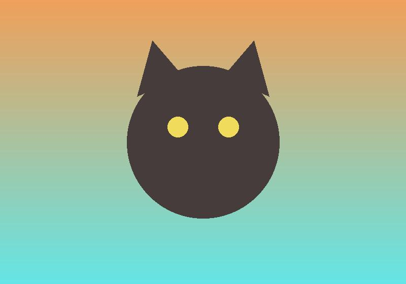

Some intro text. A window with an image:

::: {.os-window title="cat.jpg" width="420px" height="280px"}

:::

A code window:

::: {.os-window title="hello.py"}
```python
def hello(name):
    print(f"hi {name}")   # comment
hello("world")
```
:::

A markdown window with dark chrome:

::: {.os-window title="Notes" theme="dark" width=500}
## Heading inside

Some **markdown** with a [link](https://quarto.org) and a list:

- one
- two
:::

A terminal via div and one via shortcode:

::: {.os-window #t1 app="terminal" title="bash" height="240px" cwd="~/repo" run="git status"}
:::







Inline run: `git status`{.os-run target="t1"} and `ls -la`{.os-run}. Launch: [New terminal]{.os-launch app="terminal" cwd="~/repo"} and [Open editor]{.os-launch app="vscode" title="Editor"}.

```{.bash .os-run target="t1"}
git init
git add .
```

Plain code:

```bash
echo not runnable
```

A floating window:

::: {.os-window title="Floating note" float=true x=520 y=-40 width=260 height=150}
I float over the page and can be dragged.
:::

More text after. Lorem ipsum dolor sit amet, consectetur adipiscing elit.
