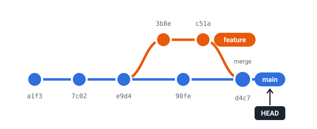

Content windows are pure HTML and CSS: no VM, no extra downloads. Wrap any Markdown in a
fenced div with the class `.os-window` and give it a `title`.

## A first window

::: {.demo}

:::: {.demo-source}
[Markdown]{.demo-label}

````markdown
::: {.os-window title="sunset.svg"}

:::
````
::::

:::: {.demo-result}
[Result]{.demo-label}

::: {.os-window title="sunset.svg"}
{fig-alt="Illustration of a sunset over hills"}
:::
::::

:::

Without a `width` a window takes the full width of its column, and its height follows
the content.

## Images

Any image works: SVG, PNG, JPEG, GIF… Captions and alt text work as usual. Use a `.win-row`
(a little CSS grid defined on this site — see [Side by side](#side-by-side)) to show
several next to each other.

::: {.win-row}

::: {.os-window title="flow-field.jpg"}
{fig-alt="Generative flow-field artwork in blue and pink"}
:::

::: {.os-window title="git-graph.svg — Preview"}
{fig-alt="Diagram of a git history with a feature branch merged into main"}
:::

:::

## Video

Videos are just HTML. Here's a small, self-hosted looping clip (muted, so browsers
allow it to autoplay):

::: {.demo}

:::: {.demo-source}
[Markdown]{.demo-label}

````markdown
::: {.os-window title="unit-circle.webm" theme="dark"}
```{=html}
<video autoplay loop muted playsinline
       poster="assets/unit-circle-poster.png">
  <source src="assets/unit-circle.webm" type="video/webm">
  <source src="assets/unit-circle.mp4" type="video/mp4">
</video>
```
:::
````
::::

:::: {.demo-result}
[Result]{.demo-label}

::: {.os-window title="unit-circle.webm" theme="dark"}
```{=html}
<video autoplay loop muted playsinline poster="assets/unit-circle-poster.png" style="display:block;width:100%;height:auto">
  <source src="assets/unit-circle.webm" type="video/webm">
  <source src="assets/unit-circle.mp4" type="video/mp4">
</video>
```
:::
::::

:::

::: {.callout-note}
Embeds from other sites (YouTube, Vimeo…) work in content windows too — but **not on pages
that also use the VM**, because those pages are cross-origin isolated. Self-host your
videos when you mix them with terminals.
:::

## Code in many languages

A code block in a window is a great way to show a "file". Syntax highlighting, line
numbers and the copy button work as usual.

::: {.demo}

:::: {.demo-source}
[Markdown]{.demo-label}

````markdown
::: {.os-window title="fib.py"}
```python
def fib(n):
    a, b = 0, 1
    for _ in range(n):
        a, b = b, a + b
    return a
```
:::
````
::::

:::: {.demo-result}
[Result]{.demo-label}

::: {.os-window title="fib.py"}
```python
def fib(n):
    a, b = 0, 1
    for _ in range(n):
        a, b = b, a + b
    return a
```
:::
::::

:::

The same function in a few more languages — note the dark windows (`theme="dark"`):

::: {.win-row .cols-2}

::: {.os-window title="fib.R"}
```r
fib <- function(n) {
  a <- 0; b <- 1
  for (i in seq_len(n)) {
    tmp <- a; a <- b; b <- tmp + b
  }
  a
}
sapply(0:10, fib)
```
:::

::: {.os-window title="fib.js" theme="dark"}
```javascript
const fib = (n) => {
  let [a, b] = [0, 1];
  for (let i = 0; i < n; i++) [a, b] = [b, a + b];
  return a;
};
console.log([...Array(11).keys()].map(fib));
```
:::

::: {.os-window title="src/main.rs" theme="dark"}
```rust
fn fib(n: u32) -> u64 {
    let (mut a, mut b) = (0u64, 1u64);
    for _ in 0..n {
        (a, b) = (b, a + b);
    }
    a
}

fn main() {
    println!("{}", fib(50));
}
```
:::

::: {.os-window title="fib.sql"}
```sql
WITH RECURSIVE fib(n, a, b) AS (
  SELECT 0, 0, 1
  UNION ALL
  SELECT n + 1, b, a + b FROM fib WHERE n < 10
)
SELECT n, a AS fib FROM fib;
```
:::

:::

## Markdown, callouts and tables

A window can hold any mix of Markdown — headings, lists, tables, callouts, even other
windows' worth of content. Perfect for "a document inside the document", e.g. a
README or an assignment sheet.

::: {.os-window title="ASSIGNMENT.md" width="640px"}
#### Assignment 2 — Version control basics

Due **Friday, 23:59**. Work in pairs and hand in a link to your repository.

1. Create a repository with a `README.md`.
2. Make **at least three** commits with meaningful messages.
3. Create a branch `feature`, commit on it and merge it back.

| Criterion | Points |
|---|---:|
| Repository exists, README present | 2 |
| Three meaningful commits | 3 |
| Branch merged | 5 |

::: {.callout-tip}
## Tip
Run `git log --oneline --graph --all` to check your history before handing in.
:::
:::

## Side by side {#side-by-side}

Windows are ordinary block elements, so any layout tool works: Quarto's
[`layout-ncol`](https://quarto.org/docs/authoring/figures.html#complex-layouts),
`.columns`, or a few lines of CSS. This site uses a small grid class:

```css
.win-row {
  display: grid;
  grid-template-columns: repeat(auto-fit, minmax(260px, 1fr));
  gap: 1.25rem;
  align-items: start;
}
```

A classic teaching pattern is a *before / after* pair:

::: {.win-row .cols-2}

::: {.os-window title="report.py — before"}
```python
total = 0
for i in range(len(prices)):
    if prices[i] > 0:
        total = total + prices[i] * qty[i]
print(total)
```
:::

::: {.os-window title="report.py — after"}
```python
total = sum(
    p * q
    for p, q in zip(prices, qty)
    if p > 0
)
print(total)
```
:::

:::

## Floating & overlapping windows

With `float=true` a window leaves the text flow: it is positioned at `x`/`y` (pixels)
inside the closest positioned container, can overlap other windows, and can be
**dragged by its title bar**. Clicking a window brings it to the front. Give the
container `position: relative` and a height — this page uses a `.stage` div for that:

````markdown
::: {.stage style="height: 380px"}

::: {.os-window title="sunset.svg" float=true x=20 y=20 width=360}

:::

::: {.os-window title="notes.md" float=true x=300 y=150 width=300}
Drag me around!
:::

:::
````

::: {.stage style="height: 400px"}

::: {.os-window title="sunset.svg" float=true x=20 y=20 width=360}
{fig-alt="Illustration of a sunset over hills"}
:::

::: {.os-window title="notes.md" float=true x=300 y=150 width=300}
#### Drag me around!

Grab a title bar and move the windows. Click one to bring it to the front.
:::

::: {.os-window title="theme.sh" float=true x=470 y=40 width=260 theme="dark"}
```bash
echo "dark chrome"
```
:::

:::

## Light & dark chrome

Every window can choose its chrome with `theme="light"` or `theme="dark"`. The default for
a whole document or project is set with:

```yaml
quarto-os:
  theme: dark
```

::: {.win-row .cols-2}

::: {.os-window title="Light" theme="light"}
Default window chrome: a light title bar with **traffic lights**, rounded corners and a soft
shadow.
:::

::: {.os-window title="Dark" theme="dark"}
`theme="dark"` — great for terminals, code and slides with dark backgrounds.
:::

:::

## Sizes

`width` and `height` accept any CSS length; bare numbers are pixels. When the content is
taller than the window, the window body scrolls.

```markdown
::: {.os-window title="320 × 180" width=320 height=180}
::: {.os-window title="50% wide" width="50%"}
::: {.os-window title="Scrolling" width="420px" height="220px"}
```

::: {.os-window title="320 × 180" width=320 height=180}
A fixed-size window: 320 pixels wide, 180 pixels tall.
:::

::: {.os-window title="50% wide" width="50%"}
This window is half as wide as the text column.
:::

::: {.os-window title="Scrolling — words.txt" width="420px" height="220px"}
```text
abacus
banana
cathedral
dolphin
eucalyptus
falafel
giraffe
harmonica
igloo
jellyfish
kaleidoscope
lighthouse
marmalade
nebula
origami
pumpernickel
quokka
rhubarb
saxophone
tambourine
```
:::

## What's next?

Content windows are static. To bring a *real* machine into your pages, continue with
[terminals](terminal.qmd), the [git lesson](git-lesson.qmd) or a [desktop](desktop.qmd).
